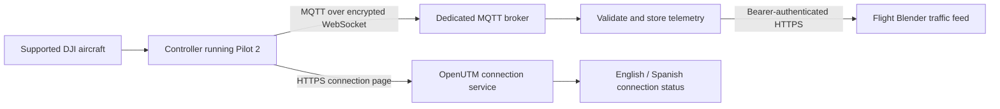

# DJI Cloud Adaptor for OpenUTM

Receive aircraft telemetry through **DJI Pilot 2 → your MQTT broker → Flight Blender**. Pilots keep using Pilot 2; they do not install an OpenUTM APK on the controller for this route.

**Status: initial implementation, locally tested; real-controller and deployment acceptance remain required.** A standalone service for compatible DJI Pilot 2 equipment and a configurable Flight Blender deployment. Source: [openutm-labs/dji-cloud-adapter](https://github.com/openutm-labs/dji-cloud-adapter).



## Start here

- Self-onboarding: [issue private invitations without collecting serials](docs/self-onboarding.md). Operators register from either supported controller; no equipment is needed by the administrator in advance.
- Pilots: [English connection guide](docs/pilot-en.md) · [Guía en español](docs/pilot-es.md).
- Service owners: [setup and hosting](docs/deployment.md).
- Developers: [DJI protocol and design](docs/protocol.md) · [Blender contract](docs/blender.md).
- Before operational use: [acceptance checklist and test evidence](docs/acceptance.md).

## Supported equipment

Self-registration currently supports these aircraft/controller combinations, subject to DJI Cloud API compatibility and validation of the exact firmware and payload:

| Aircraft | Controller |
|---|---|
| Mavic 3 Enterprise | RC Pro Enterprise |
| Matrice 400 | RC Plus 2 Enterprise Enhanced |

Check DJI's [Cloud API product support](https://developer.dji.com/doc/cloud-api-tutorial/en/overview/product-support.html) before deploying. Each combination needs real-device acceptance. This implementation does not automatically support every Cloud API product or aircraft that can install an APK.

## Implemented

- A responsive English/Spanish controller page using DJI's documented JSBridge licence verification, API and `thing` modules.
- Private connection codes per controller; controller matching before MQTT credentials are returned. This identifies the configured device, not the human pilot.
- A dedicated Mosquitto broker with per-controller topic ACLs, password authentication and no command-publishing permissions.
- Topology acknowledgement and aircraft OSD reception on exact allow-listed topics. Controller GPS, unknown aircraft, retained messages, stale timestamps and invalid coordinates are rejected.
- Correct mapping of DJI `height` (WGS84 ellipsoid metres) to Blender `altitude_mm`; original source timestamps are preserved.
- SQLite WAL outbox, local duplicate suppression, retries, OAuth renewal or a supplied bearer token, bounded live-delivery age and seven-day retention by default.
- Controller status, protected administrator diagnostics, health/readiness endpoints, Docker deployment and automated tests.

No flight-control, remote-stick, take-off, landing, mission-upload or firmware-update feature is implemented. The page loads only the API and telemetry modules. It does not activate media upload or livestreaming.

## What this first version does with Blender

It posts traffic observations to `/flight_stream/set_air_traffic/{session_id}`. It **does not automatically create flight declarations, assert flight permissions, assign pilot identities, or submit ASTM Remote ID flights**. Per-aircraft session IDs are traffic-feed identifiers, not automatically declared-operation IDs. See the [contract and remaining integration decisions](docs/blender.md).

An HTTP acceptance is recorded as **API accepted**, not “flight successfully stored.” Blender processes observations asynchronously; the organisation must check the downstream record/dashboard during acceptance.

Queued positions older than the configured live-feed age (60 seconds by default) are retained as expired records rather than replayed as current aircraft positions. This is not an offline flight-log uploader. Pilot-to-cloud connectivity still requires internet.

## Run the tests

For developers with Python 3.12+, uv, Node.js 22+ and Docker:

```sh
uv sync --frozen
uv run ruff check src tests
uv run ruff format --check src tests
uv run pytest -q
node --test tests/portal.test.cjs
RUN_MQTT_INTEGRATION=1 uv run pytest tests/test_mqtt_integration.py -q
# After building the application image:
RUN_STACK_INTEGRATION=1 uv run pytest tests/test_stack_integration.py -q
```

The broker integration tests create and remove only their own containers and synthetic configuration. They do not contact production services or operate an aircraft. The HTTP contract receiver is a test double; no production credentials are required.

## DJI API versions

This receiver implements the documented **Pilot 2 Cloud API MQTT/JSBridge** interface. DJI also publishes [Cloud API 2](https://github.com/dji-sdk/Cloud-API-2), a separate platform/runtime with its own SDKs and onboarding. That product is not installed by this repository, and compatibility with its licence/runtime must not be assumed. We use the basic telemetry protocol directly rather than depending on DJI's discontinued demonstration server. See [research references and version limits](docs/protocol.md).
