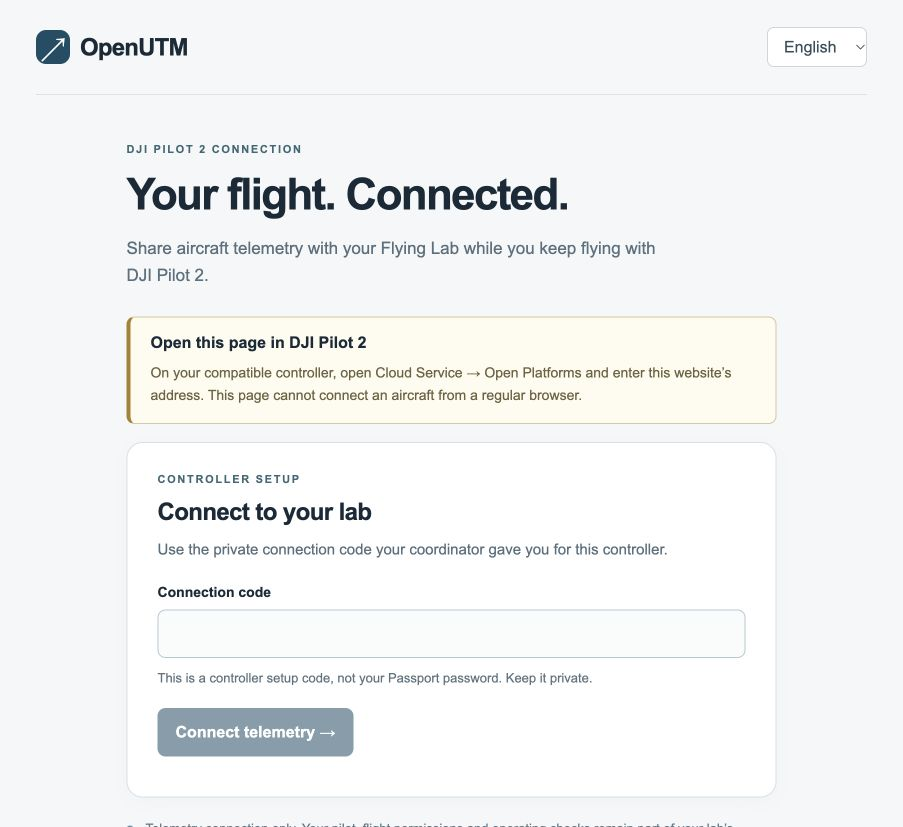
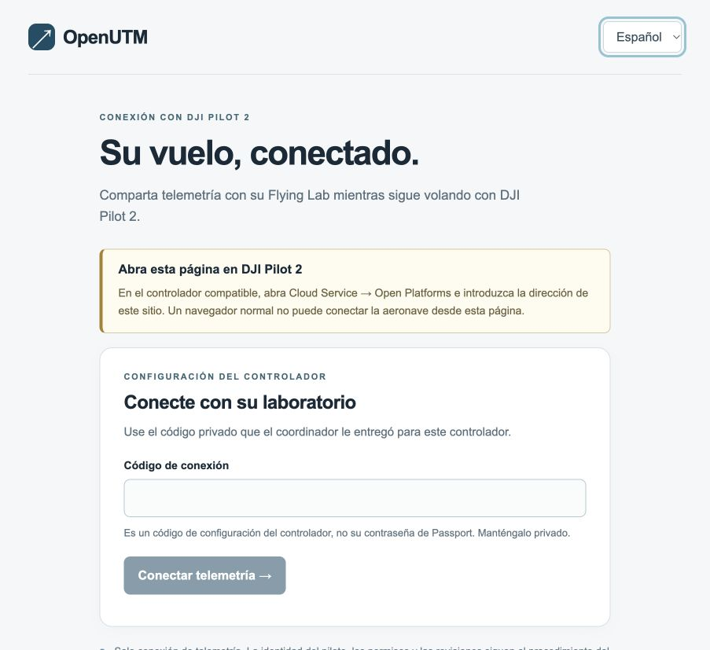

# Acceptance and test evidence

[Home](../README.md) · [Deployment](deployment.md) · [Protocol](protocol.md)

## Software integration continuation, 19 October 2026

See the [sanitised acceptance report](reports/2026-10-19-simulation.md) and
[reproducible harness procedure](simulation.md). The local built-container pipeline
now includes verified HTTPS/WSS, explicit simulation identity/classification, three
independent observation readbacks and app/broker restarts. The receiver is local test
infrastructure. Real hosted OAuth/protected reads pass, while synthetic writes await
an agreed reserved context and operational-consumer filtering. No public deployment
or hardware/licensing acceptance is claimed.

## Local verification, 19 October 2026

The automated tests use fictional identifiers, synthetic telemetry and local receiver credentials. They do not contact production APIs or command an aircraft.

| Check | Evidence / scope |
|---|---|
| Protocol and authentication | Tests cover invalid coordinates/height/time, stale and retained messages, unknown aircraft, wrong gateway, partial OSD, duplicate samples, private bootstrap, wrong-controller revocation, session expiry, logout and rate limiting. |
| Blender contract | HTTP test transport checks the exact observation envelope, endpoint, millimetre conversion, timestamp preservation, retry behaviour, OAuth renewal, authentication failure and permanent rejection. The administrator access check submits only a protected GET and suppresses credentials/server bodies. |
| Real MQTT broker | Mosquitto with generated passwords/ACLs; topology receipt, duplicate delivery, TCP/WebSocket connection, bad-password rejection and prohibited publishing. |
| Built-container recovery | Application + real broker + actual local HTTP contract receiver. Receiver initially returns 503; adapter restarts with a pending sample; delivery then succeeds with the original source timestamp/event identifier. Test accounts for Docker's dynamically allocated host port changing after restart. |
| Pilot page | Node tests exercise the documented native return envelope, licence/controller failures, component-load errors, unavailable browser storage and stale status handling. Browser preview was inspected in English and Spanish. |
| Container packaging | Docker image build, Compose validation, local app/broker startup, private endpoint denial and health/readiness checks. Production proxy configuration validated with Caddy. |

Run instructions are in the [README](../README.md). Full stack test:

```sh
docker build -t dji-cloud-adaptor-app .
RUN_MQTT_INTEGRATION=1 RUN_STACK_INTEGRATION=1 uv run pytest -q
node --test tests/portal.test.cjs
```

The repository includes CI for automated verification. Check the workflow results for the commit you intend to deploy; they do not replace real-device acceptance. The current test client emits a Starlette/httpx deprecation warning; the runtime HTTP client and test assertions still pass.

## Browser previews

These are real screenshots of the local page in an ordinary browser, **not proof of a controller connection**. The disabled button and reminder are expected outside Pilot 2. The code fields are empty; no credentials or real aircraft information are pictured.





## Required before deployment

- [ ] Review the release commit and its CI results before deployment.
- [ ] Choose hosting, domain, persistent storage, monitoring and support ownership.
- [ ] Verify the DJI application's Cloud API product selection and licence on the actual controller. Configured licence fields alone are not verification.
- [ ] Confirm exact supported models, firmware and payloads. Operators can now supply their controller/aircraft pairing through invitation-based self-registration; alternatively pre-provision it privately. No fictional pair should be distributed as a real setup.
- [ ] Configure the target deployment’s OAuth client; verify token acquisition/renewal and a protected read with normal TLS verification.
- [ ] Confirm production credential ownership/rotation and traffic classification; verify actual aircraft writes and downstream processing during supervised acceptance.
- [ ] Complete the intended pilot/account/declaration workflow separately; do not treat device telemetry setup as membership or flight approval.

## Required on each real equipment combination

Perform this under the organisation’s approved ground/flight procedures. Ground connection checks do not require starting motors or taking off.

1. Open the HTTPS address through Pilot 2's **Cloud Service → Open Platforms**. Confirm certificate trust and readable layout on the actual screen.
2. Verify the licence, correct-controller setup and MQTT TLS/WebSocket connection. Record Pilot/firmware versions and the TLS chain used, without publishing credentials.
3. Confirm topology and a current aircraft position. Check gateway/aircraft identity, height datum, units and timestamps against the manufacturer display/data.
4. Confirm Blender API acceptance and **downstream persistence/display**, including async worker health. Agree source classification and identifier handling.
5. Verify that closing/reopening the platform resumes the correct workspace, and that an expired session requires its connection code again.
6. Simulate approved connectivity interruptions while on the ground. Check stale indicators, reconnects and that old samples are not republished as current positions.
7. Test adapter/broker restart and controller access revocation under a supervised maintenance exercise. Check that old credentials cannot reconnect.
8. Check that the pilot retains normal aircraft control and is never prompted for cloud flight-control authority by this adapter. Do not enable DRC or live flight controls for onboarding.
9. If operational use is approved by the organisation, conduct its supervised field-validation programme. Verify reporting and any declared-operation integration before wider rollout.

## Not yet verified

Real aircraft telemetry on each supported combination, application licence verification on hardware, controller TLS trust, target-deployment traffic writes/downstream visibility, full flight operations and Cloud API 2 runtime compatibility all require separate acceptance.

## Self-onboarding evidence

Invitation-based registration supports both target models without collecting serial numbers first. Pilot 2 supplies both equipment IDs. A new deployment can start with an empty fleet; administrators issue private invitations when operators are ready. Dynamic broker provisioning and exact per-device grants avoid restarting the service for new equipment.

Automated tests cover expiry/replay, duplicate equipment, registration recovery, persistence/revocation, broker-control and aircraft-command denial, both supported models, and telemetry delivery from an initially empty fleet without restarting. Browser tests cover native IDs, missing aircraft, licence failure, retry, and saved-code recovery after a connection failure. Hardware, actual hosted signup, Pilot 2 TLS/licence and target-deployment traffic ingestion still need acceptance.
