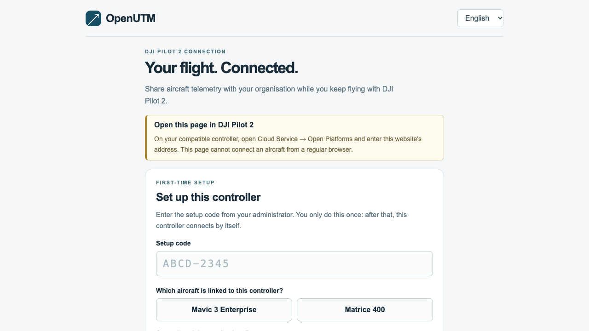
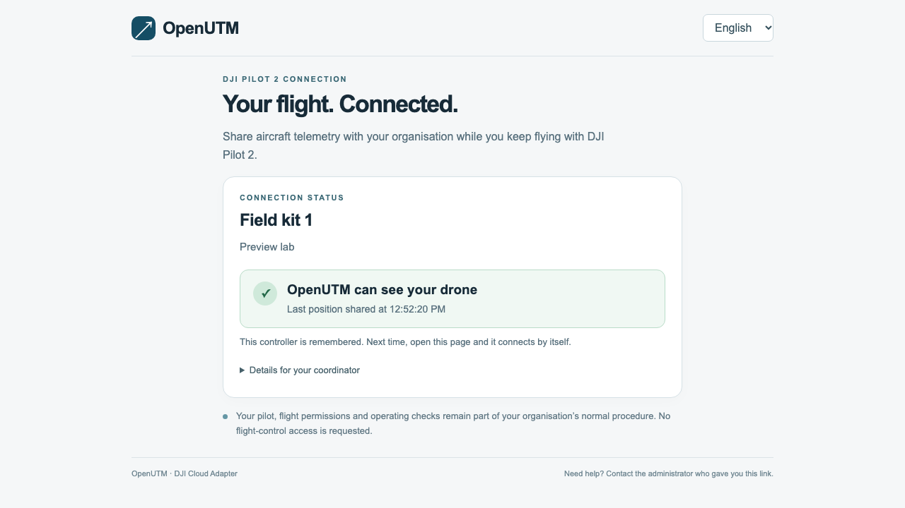

# Connect DJI Pilot 2 to OpenUTM

[Español](pilot-es.md) · [Project home](../README.md)

This procedure sends aircraft telemetry to OpenUTM while Pilot 2 stays the flight application. Your administrator must accept the service and equipment for the intended activity. A browser preview does not establish a connection.

## Before you start

Get two things from your administrator: the page **address** and a **setup code** (8 characters, like `K7PQ-4XM9`). Use the accepted aircraft, controller, firmware and payload. The controller needs internet.

No OpenUTM APK or personal OpenUTM signup is necessary. Setup codes do not identify the pilot. The lab's identity, planning and flight-permission procedures apply separately.

## Set up the controller (once)

1. Keep the aircraft on the ground, powered on and linked to its controller.
2. Open **DJI Pilot 2 → Cloud Service → Open Platforms** and enter the address. Check that no certificate warning shows.
3. Choose **English** or **Español** at the top if needed.
4. Type the **setup code**. Capitals, spaces and the dash don't matter.
5. If asked, tap your aircraft: **Mavic 3 Enterprise** or **Matrice 400**. (When your organisation accepts only one model, the page doesn't ask.)
6. Tap **Connect →**.

That's all. Pilot 2 reads the serial numbers itself, and the controller is **remembered**: there is no code to write down. Each setup code works once, for one controller and its aircraft, and expires. The nickname field is optional.

If the page says **Open this page in DJI Pilot 2**, you are in a regular browser; go back to **Open Platforms**. If the address, certificate or menu looks different, stop and contact your administrator.

*Browser preview. Setup is disabled outside Pilot 2; no real codes or equipment IDs are shown.*

### Every day after that

Open **Cloud Service → Open Platforms** and the page reconnects by itself (**Reconnecting this controller…**). Nothing to type. The controller stays remembered while it is used at least once every 30 days (your administrator can change this).

If it says **Couldn't reach OpenUTM**, check the controller's internet and tap **Try again**. If it asks for a setup code again, the controller was disconnected or its access was removed: ask your administrator for a new setup code.

Some organisations give a long **connection code** instead of setup codes. Use **I have a connection code instead**, enter it once, and the controller is remembered the same way.

## Check the connection

The page shows one line:

| You see | Meaning |
|---|---|
| ✓ **OpenUTM can see your drone** | Positions are arriving and being shared. |
| **Connected: waiting for your drone** | Turn on the aircraft, keep it linked and wait for GPS. |
| **Connected: sending saved positions** | Catching up after a gap; it clears by itself. |
| **Connecting to OpenUTM…** | Check the controller's internet. |
| ! **Your drone isn't reaching OpenUTM** | A server-side problem. Tell your administrator the time and what you see. |
| ! **Can't check the connection** | The page can't reach OpenUTM; positions may still be sending. Check internet. |

*Preview with a simulated controller and fictional names.*

Ask the coordinator to confirm current data from the correct aircraft in Blender or the dashboard. **Details for your coordinator** shows the technical states (controller, aircraft telemetry, Flight Blender API), times and the number of positions waiting. A green line alone does not prove storage of a full track. Do not start motors or take off for this check; use the lab's normal ground and GPS procedure.

## Declare a flight when enabled

If **Flight declaration** is available, your administrator has enabled the area-planning workflow. Keep the aircraft on the ground at take-off.

1. Check the selected pilot and aircraft. Resize the circle on the map, with the radius buttons or by entering a value. Set height, start time and duration; the preset buttons reduce typing.
2. Confirm that the plan covers the flight and your operating checks are complete. Select **Review plan** and check the saved boundary and flight window. Open **Declaration details** for coordinates and WGS84 altitude limits.
3. Select **Submit declaration** once. If submission is unconfirmed, use **Check status** or contact the administrator. Do not create another plan to recover a lost response.
4. Wait for **Accepted** and recorded approval. Within the flight window, select **Activate declaration** when ready to fly.
5. After landing, select **End declaration after landing**. If samples are waiting, let them drain and select End again. Record any rejected or expired samples with the coordinator.

Use **Edit plan** to change a draft and review it again. The map shows streets, not airspace restrictions. This declares a VLOS circle around take-off. It does not import your Pilot 2 mission or measure terrain clearance. Your selected name is a responsibility record, not personal sign-in. Approval in Blender does not replace required flight permissions. Follow the organisation’s procedure if this planner does not cover your flight.

## Use and close the connection

Keep Pilot 2 as the flight application. Do not enable cloud flight-control authority. Use the declaration panel only if your administrator enabled it. The connection does not grant flight permission or upload photographs.

Internet loss can leave gaps that the service cannot recover. Obey the lab's connection-loss procedure. Do not change flight-control applications during flight.

After landing, complete the lab's shutdown procedure, check the last position time with the coordinator, and record missing data or unresolved faults. **You don't need to disconnect after each flight.**

**Disconnect and forget this controller** (under **Details for your coordinator**) stops sending and removes the remembered connection. Use it only when the controller leaves your organisation or changes hands; afterwards it needs a new setup code. Report a lost controller to the administrator, who can remove its access.

Keep manufacturer logs and photographs under the lab's reporting procedure.

## Correct a fault

| Indication | Action |
|---|---|
| Different menu, or no setup-code screen | Get the correct access instructions from the administrator. |
| Licence failure | Tell the administrator to check the DJI application credentials and controller compatibility. |
| No aircraft ID or telemetry | Check aircraft power, controller link, the registered pair and GPS on the ground. |
| **Check the setup code** | Retype it. If it still fails, it has expired or been used: ask for a new one. |
| **Registration is saved** | Keep the page open and tap **Connect** again with the same equipment. |
| **Already registered** or wrong controller | Ask the administrator to reconnect it. Do not register it again. |
| **Too many attempts** | Wait one minute before you try again. |
| Asks for a setup code again | The controller was disconnected or its access removed. Ask for a new setup code. |
| Blender pending or not configured | Contact the administrator. Do not change dates or recreate operations. |

Report the step, exact message, equipment models, Pilot version, time and time zone through the lab's private support channel. Exclude setup and connection codes, passwords and credentials.
