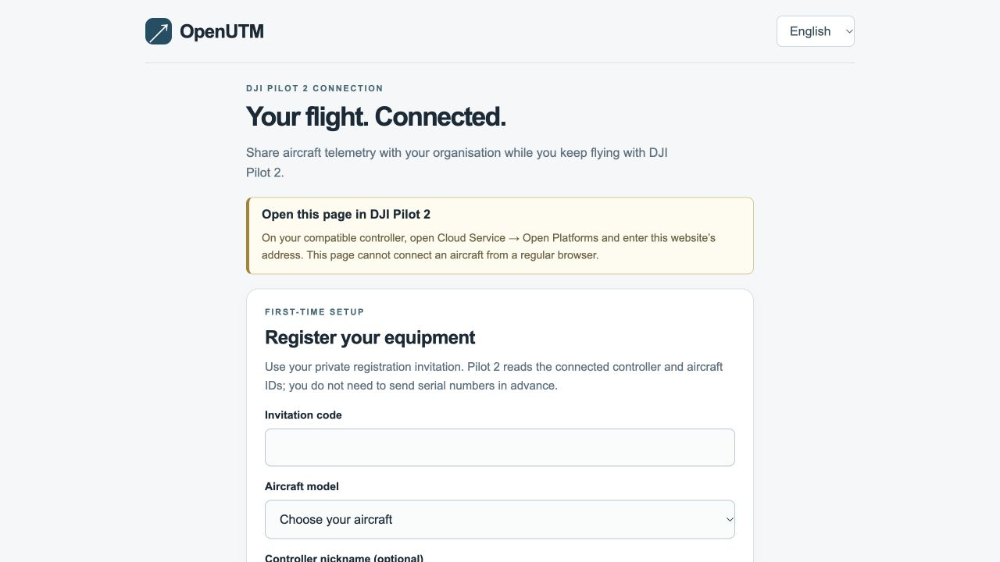

# Connect DJI Pilot 2 to OpenUTM

[Español](pilot-es.md) · [Project home](../README.md)

This procedure sends aircraft telemetry to OpenUTM while Pilot 2 stays the flight application. Your administrator must accept the service and equipment for the intended activity. A browser preview does not establish a connection.

**Panama connection address:** [https://dji-cloud-api.panama.openutm.net/](https://dji-cloud-api.panama.openutm.net/). Open it inside Pilot 2. Get the private invitation or saved connection code from your coordinator.

## Before you start

Get the HTTPS connection address and a private invitation or existing controller connection code from your administrator. Use the accepted aircraft, controller, firmware and payload. The controller needs internet.

No OpenUTM APK or personal OpenUTM signup is necessary. Equipment codes do not identify the pilot. The lab's identity, planning and flight-permission procedures apply separately.

## Open the connection page

1. Keep the aircraft on the ground and connected to its controller.
2. Open **DJI Pilot 2 → Cloud Service → Open Platforms**.
3. Enter the supplied HTTPS address.
4. Make sure that the address is correct and no certificate warning shows.
5. Select **English** or **Español**.

If the address, certificate or menu is different, stop and contact the administrator. **Open this page in DJI Pilot 2** means the page is in a regular browser. Return to **Open Platforms**.

## Register or reconnect

Complete only the applicable branch, then examine the connection statuses.

### First connection: use an invitation

1. Select **First time here? Register this controller**.
2. Enter the private **Invitation code**.
3. Select **Mavic 3 Enterprise** or **Matrice 400** to agree with your aircraft.
4. Select **Register and connect →**.
5. Use **Show code** to keep the generated **connection code** in the lab's private location.

Pilot 2 reads the serial numbers automatically. A controller nickname is optional. Each invitation expires and registers one controller–aircraft pair. Another pair needs another invitation. Keep codes out of screenshots.

*Browser preview. Registration is disabled outside Pilot 2; no real codes or equipment IDs are shown.*

### Later connections: use the saved code

1. Enter this controller's saved **Connection code**.
2. Select **Connect telemetry →**.
3. Wait for license verification and connection.

If the code is lost, contact the administrator for recovery. Do not register the same equipment again.

## Examine the connection statuses

| Indication | Expected result |
|---|---|
| **Controller connection** | **Connected**: Pilot 2 reports a broker connection. |
| **Aircraft telemetry** | **Connected**: the adapter received a current aircraft position. |
| **Flight Blender** | **API accepted**: the API accepted a current sample. |

1. Examine **Last aircraft sample**, **Last API acceptance** and **Waiting to send** for current data or delayed delivery.
2. Tell the coordinator to examine the received data in Blender or the available dashboard.

**Not configured**, **Not recent**, **Waiting** and **Status unavailable** need correction. **API accepted** alone does not prove storage of a full track. The check is complete when the coordinator finds current data from the correct aircraft. Do not start motors or take off for this check; use the lab's normal ground and GPS procedure.

## Use and close the connection

Keep Pilot 2 as the flight application. Do not enable cloud flight-control authority. This connection does not create declarations, grant flight permission or upload photographs.

Internet loss can leave gaps that the service cannot recover. Obey the lab's connection-loss procedure. Do not change flight-control applications during flight.

1. With the aircraft on the ground, complete the lab's shutdown procedure.
2. Examine the last sample time and pending data with the coordinator.
3. Record missing data or unresolved faults.
4. Select **Disconnect this controller**.

Keep manufacturer logs and photographs under the lab's reporting procedure. Closing the page does not revoke equipment access; report a lost controller to the administrator.

## Correct a fault

| Indication | Action |
|---|---|
| Missing registration button or different menu | Get the correct access instructions from the administrator. |
| License failure | Tell the administrator to examine DJI application credentials and controller compatibility. |
| No aircraft ID or telemetry | Examine aircraft power, controller connection, registered pair and GPS on the ground. |
| Expired invitation | Get a replacement if registration has not completed. |
| **Registration is saved** | Keep the page open and retry **Register and connect** with the same equipment. |
| Already registered, lost code or wrong controller | Get recovery or the correct code. Do not change identities. |
| Too many attempts | Wait one minute before you try again. |
| Session ended | Reconnect with this controller's saved code. |
| Blender pending or not configured | Contact the administrator. Do not change dates or recreate operations. |

Report the step, exact message, equipment models, Pilot version, time and time zone through the lab's private support channel. Exclude connection codes, passwords and credentials.
