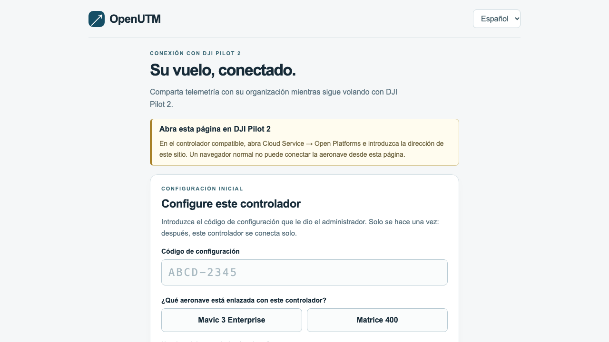
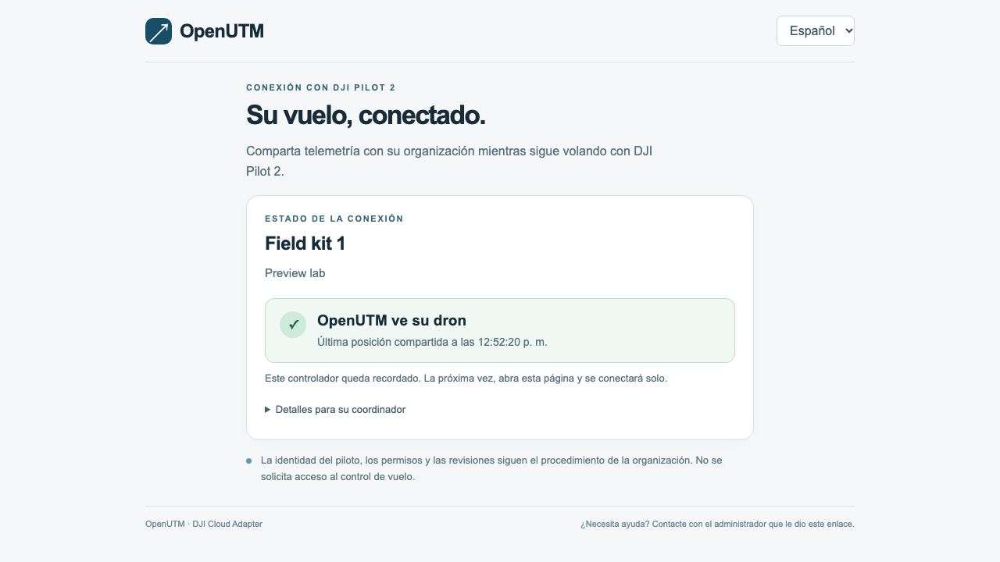

# Conectar DJI Pilot 2 con OpenUTM

[English](pilot-en.md) · [Inicio del proyecto](../README.md)

Este procedimiento envía telemetría a OpenUTM y mantiene Pilot 2 como aplicación de vuelo. El administrador debe aceptar el servicio y el equipo para la actividad prevista. Una vista previa en navegador no establece conexión.

## Antes de empezar

Pida dos cosas al administrador: la **dirección** de la página y un **código de configuración** (8 caracteres, por ejemplo `K7PQ-4XM9`). Use aeronave, controlador, firmware y carga útil aceptados. El controlador necesita internet.

No necesita APK OpenUTM ni registro personal en OpenUTM. Los códigos de configuración no identifican al piloto. La identidad, planificación y permisos de vuelo siguen los procedimientos del laboratorio.

## Configurar el controlador (una sola vez)

1. Mantenga la aeronave en tierra, encendida y enlazada con su controlador.
2. Abra **DJI Pilot 2 → Cloud Service → Open Platforms** e introduzca la dirección. Compruebe que no aparece ningún aviso de certificado.
3. Elija **Español** o **English** arriba si hace falta.
4. Escriba el **código de configuración**. Las mayúsculas, los espacios y el guion no importan.
5. Si se le pide, toque su aeronave: **Mavic 3 Enterprise** o **Matrice 400**. (Si su organización acepta un solo modelo, la página no pregunta.)
6. Toque **Conectar →**.

Eso es todo. Pilot 2 lee los números de serie, y el controlador queda **recordado**: no hay ningún código que anotar. Cada código de configuración sirve una vez, para un controlador y su aeronave, y vence. El nombre del controlador es opcional.

Si la página dice **Abra esta página en DJI Pilot 2**, está en un navegador normal; vuelva a **Open Platforms**. Si la dirección, el certificado o el menú no coinciden, deténgase y contacte con el administrador.

*Vista previa en navegador. La configuración está desactivada fuera de Pilot 2; no muestra códigos ni identificadores reales.*

### Los días siguientes

Abra **Cloud Service → Open Platforms** y la página se reconecta sola (**Reconectando este controlador…**). No hay que escribir nada. El controlador sigue recordado mientras se use al menos una vez cada 30 días (el administrador puede cambiarlo).

Si dice **No se pudo contactar con OpenUTM**, compruebe el internet del controlador y toque **Reintentar**. Si vuelve a pedir un código de configuración, el controlador se desconectó o se retiró su acceso: pida un código nuevo al administrador.

Algunas organizaciones entregan un **código de conexión** largo en lugar de códigos de configuración. Use **Tengo un código de conexión**, introdúzcalo una vez y el controlador queda recordado igual.

## Comprobar la conexión

La página muestra una sola línea:

| Ve | Significa |
|---|---|
| ✓ **OpenUTM ve su dron** | Llegan posiciones y se comparten. |
| **Conectado: esperando su dron** | Encienda la aeronave, manténgala enlazada y espere la señal GPS. |
| **Conectado: enviando posiciones guardadas** | Se recupera tras un corte; se resuelve solo. |
| **Conectando con OpenUTM…** | Compruebe el internet del controlador. |
| ! **La posición de su dron no llega a OpenUTM** | Problema del servidor. Indique al administrador la hora y lo que ve. |
| ! **No se puede comprobar la conexión** | La página no llega a OpenUTM; puede que las posiciones se sigan enviando. Compruebe internet. |

*Vista previa con un controlador simulado y nombres ficticios.*

Pida al coordinador que confirme datos recientes de la aeronave correcta en Blender o en el panel. **Detalles para su coordinador** muestra los estados técnicos (controlador, telemetría de la aeronave, API de Flight Blender), las horas y las posiciones pendientes. Una línea verde no demuestra que se haya conservado toda la trayectoria. No arranque motores ni despegue para esta comprobación; use el procedimiento normal en tierra y de recepción GPS.

## Declarar un vuelo cuando esté habilitado

Si aparece **Declaración de vuelo**, el administrador habilitó la planificación del área. Mantenga la aeronave en tierra en el punto de despegue.

1. Compruebe el piloto y la aeronave seleccionados. Ajuste el círculo en el mapa, con los botones de radio o introduciendo un valor. Defina altura, inicio y duración; los botones de duración reducen la escritura.
2. Confirme que el plan cubre el vuelo y que completó las comprobaciones operativas. Pulse **Revisar plan** y compruebe el límite guardado y el horario. Abra **Detalles de declaración** para ver coordenadas y límites de altitud WGS84.
3. Pulse **Enviar declaración** una vez. Si el envío no está confirmado, use **Consultar estado** o contacte al administrador. No cree otro plan para recuperar una respuesta perdida.
4. Espere **Aceptada** y la aprobación registrada. Dentro del horario, pulse **Activar declaración** cuando esté listo para volar.
5. Tras aterrizar, pulse **Finalizar declaración tras aterrizar**. Si quedan muestras en espera, deje que se envíen y pulse Finalizar otra vez. Registre las muestras rechazadas o vencidas con el coordinador.

Use **Editar plan** para modificar un borrador y revisarlo otra vez. El mapa muestra calles, no restricciones del espacio aéreo. Se declara un círculo VLOS alrededor del despegue. No se importa la misión de Pilot 2 ni se mide la distancia al terreno. Su nombre registra responsabilidad, no es un inicio de sesión personal. La aprobación en Blender no sustituye los permisos requeridos. Siga el procedimiento de la organización si este planificador no cubre su vuelo.

## Usar y cerrar la conexión

Mantenga Pilot 2 como aplicación de vuelo. No active autoridad de control de vuelo en nube. Use el panel de declaración solo si está habilitado. La conexión no concede permisos ni sube fotografías.

La pérdida de internet puede dejar huecos irrecuperables. Siga el procedimiento del laboratorio para pérdida de conexión. No cambie de aplicación de control durante el vuelo.

Tras aterrizar, complete el cierre del laboratorio, revise con el coordinador la hora de la última posición y registre datos ausentes o fallos pendientes. **No hace falta desconectar después de cada vuelo.**

**Desconectar y olvidar este controlador** (en **Detalles para su coordinador**) detiene el envío y elimina la conexión recordada. Úselo solo cuando el controlador deje su organización o cambie de manos; después necesitará un código de configuración nuevo. Comunique la pérdida de un controlador al administrador, que puede retirar su acceso.

Conserve registros del fabricante y fotografías según el procedimiento del laboratorio.

## Resolver un fallo

| Indicación | Acción |
|---|---|
| El menú difiere o no aparece la pantalla del código | Obtenga las instrucciones correctas del administrador. |
| Fallo de licencia | Pida revisar credenciales de la aplicación DJI y compatibilidad del controlador. |
| Sin identificador de aeronave o telemetría | Revise en tierra alimentación, enlace, combinación registrada y GPS. |
| **Revise el código de configuración** | Vuelva a escribirlo. Si sigue fallando, venció o ya se usó: pida uno nuevo. |
| **El registro está guardado** | Mantenga la página abierta y toque **Conectar** de nuevo con el mismo equipo. |
| **Ya están registrados** o controlador incorrecto | Pida al administrador que lo vuelva a conectar. No lo registre otra vez. |
| **Demasiados intentos** | Espere un minuto antes de repetir. |
| Vuelve a pedir un código de configuración | El controlador se desconectó o se retiró su acceso. Pida un código nuevo. |
| Blender pendiente o sin configurar | Contacte con el administrador. No cambie fechas ni recree operaciones. |

Informe del paso, mensaje exacto, modelos, versión de Pilot, hora y zona horaria por el canal privado del laboratorio. Excluya códigos de configuración y de conexión, contraseñas y credenciales.
