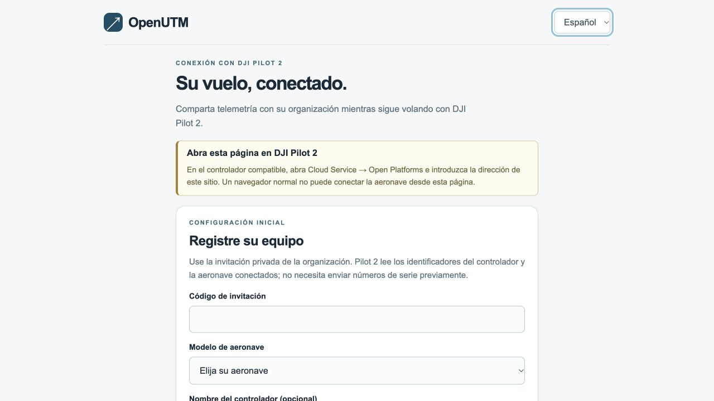

# Conectar DJI Pilot 2 con OpenUTM

[English](pilot-en.md) · [Inicio del proyecto](../README.md)

Este procedimiento envía telemetría a OpenUTM y mantiene Pilot 2 como aplicación de vuelo. El administrador debe aceptar el servicio y el equipo para la actividad prevista. Una vista previa en navegador no establece conexión.

## Antes de empezar

Obtenga del administrador la dirección HTTPS y una invitación privada o el código existente del controlador. Use aeronave, controlador, firmware y carga útil aceptados. El controlador necesita internet.

No necesita APK OpenUTM ni autorregistro personal OpenUTM. Los códigos del equipo no identifican al piloto. La identidad, planificación y permisos de vuelo siguen los procedimientos del laboratorio.

## Abrir la página de conexión

1. Mantenga la aeronave en tierra y conectada al controlador.
2. Abra **DJI Pilot 2 → Cloud Service → Open Platforms**.
3. Introduzca la dirección HTTPS suministrada.
4. Compruebe que la dirección es correcta y no hay aviso de certificado.
5. Seleccione **Español** o **English**.

Si dirección, certificado o menú no coinciden, deténgase y contacte con el administrador. **Abra esta página en DJI Pilot 2** indica que usa un navegador normal. Vuelva a **Open Platforms**.

## Registrar o reconectar

Complete solo la opción correspondiente y después revise los estados de conexión.

### Primera conexión: usar una invitación

1. Seleccione **¿Primera vez? Registre este controlador**.
2. Introduzca el **Código de invitación** privado.
3. Seleccione **Mavic 3 Enterprise** o **Matrice 400**, según su aeronave.
4. Seleccione **Registrar y conectar →**.
5. Use **Mostrar código** para guardar el **código de conexión** generado en la ubicación privada del laboratorio.

Pilot 2 lee los números de serie automáticamente. El nombre del controlador es opcional. Cada invitación vence y registra un controlador con una aeronave. Otra combinación necesita otra invitación. No incluya códigos en capturas.

*Vista previa en navegador. El registro está desactivado fuera de Pilot 2; no muestra códigos ni identificadores reales.*

### Conexiones posteriores: usar el código guardado

1. Introduzca el **Código de conexión** guardado para este controlador.
2. Seleccione **Conectar telemetría →**.
3. Espere la verificación de licencia y la conexión.

Si pierde el código, contacte con el administrador para recuperarlo. No registre el mismo equipo otra vez.

## Revisar los estados de conexión

| Indicación | Resultado esperado |
|---|---|
| **Conexión del controlador** | **Conectado**: Pilot 2 indica conexión con el servicio de telemetría. |
| **Telemetría de la aeronave** | **Conectado**: el adaptador recibió una posición reciente. |
| **Flight Blender** | **API: aceptado**: la API aceptó una muestra reciente. |

1. Abra **Detalles de conexión** y revise **Última muestra de la aeronave**, **Última aceptación de la API** y **Pendientes de envío** para detectar datos antiguos o retrasos.
2. Pida al coordinador que examine los datos recibidos en Blender o en el panel disponible.

**Sin configurar**, **Sin datos recientes**, **En espera** y **Estado no disponible** necesitan corrección. **API: aceptado** no demuestra que se haya conservado toda la trayectoria. La comprobación termina cuando el coordinador encuentra datos recientes de la aeronave correcta. No arranque motores ni despegue para comprobar la conexión; use el procedimiento normal en tierra y de recepción GPS.

## Declarar un vuelo cuando esté habilitado

Si aparece **Declaración de vuelo**, el administrador habilitó la planificación del área. Mantenga la aeronave en tierra en el punto de despegue.

1. Compruebe el piloto y la aeronave seleccionados. Ajuste el círculo en el mapa, con los botones de radio o introduciendo un valor. Defina altura, inicio y duración; los botones de duración reducen la escritura.
2. Confirme que el plan cubre el vuelo y que completó las comprobaciones operativas. Pulse **Revisar plan** y compruebe el límite guardado y el horario. Abra **Detalles de declaración** para ver coordenadas y límites de altitud WGS84.
3. Pulse **Enviar declaración** una vez. Si el envío no está confirmado, use **Consultar estado** o contacte al administrador. No cree otro plan para recuperar una respuesta perdida.
4. Espere **Aceptada** y la aprobación registrada. Dentro del horario, pulse **Activar declaración** cuando esté listo para volar.
5. Tras aterrizar, pulse **Finalizar declaración tras aterrizar**. Si quedan muestras en espera, deje que se envíen y pulse Finalizar otra vez. Registre las muestras rechazadas o vencidas con el coordinador.

Use **Editar plan** para modificar un borrador y revisarlo otra vez. El mapa muestra calles, no restricciones del espacio aéreo. Se declara un círculo VLOS alrededor del despegue. No se importa la misión de Pilot 2 ni se mide la distancia al terreno. Su nombre registra responsabilidad, no es un inicio de sesión personal. La aprobación en Blender no sustituye los permisos requeridos. Siga el procedimiento de la organización si este planificador no cubre su vuelo.

## Usar y cerrar la conexión

Mantenga Pilot 2 como aplicación de vuelo. No active autoridad de control de vuelo en nube. Use el panel de declaración solo si está habilitado. La conexión no concede permisos ni sube fotografías.

La pérdida de internet puede dejar huecos irrecuperables. Siga el procedimiento del laboratorio para pérdida de conexión. No cambie de aplicación de control durante el vuelo.

1. Con la aeronave en tierra, complete el cierre del laboratorio.
2. Revise la hora de la última muestra y los datos pendientes con el coordinador.
3. Registre datos ausentes o fallos pendientes.
4. Seleccione **Desconectar este controlador**.

Conserve registros del fabricante y fotografías según el procedimiento del laboratorio. Cerrar la página no revoca el acceso del equipo; comunique la pérdida de un controlador al administrador.

## Resolver un fallo

| Indicación | Acción |
|---|---|
| Falta el botón de registro o el menú difiere | Obtenga las instrucciones correctas del administrador. |
| Fallo de licencia | Pida revisar credenciales de la aplicación DJI y compatibilidad del controlador. |
| Sin identificador de aeronave o telemetría | Revise en tierra alimentación, enlace, combinación registrada y GPS. |
| Invitación vencida | Obtenga otra si aún no se ha completado el registro. |
| **El registro está guardado** | Mantenga la página abierta y repita **Registrar y conectar** con el mismo equipo. |
| Equipo ya registrado, código perdido o controlador incorrecto | Solicite recuperación o el código correcto. No cambie de identidad. |
| Demasiados intentos | Espere un minuto antes de repetir. |
| Sesión terminada | Reconecte con el código guardado de este controlador. |
| Blender pendiente o sin configurar | Contacte con el administrador. No cambie fechas ni recree operaciones. |

Informe del paso, mensaje exacto, modelos, versión de Pilot, hora y zona horaria por el canal privado del laboratorio. Excluya códigos, contraseñas y credenciales.
